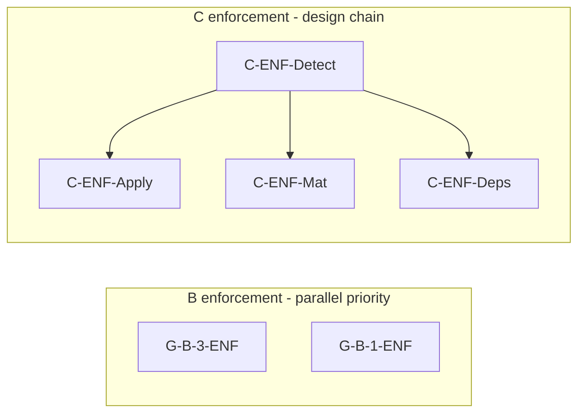

# Implementation plan — post §11C sign-off (Git 2026-10-15)

**Prerequisite:** §11C full sign in [phase-mutability-matrix.md](./phase-mutability-matrix.md) §11C · Notion [Décision §11C](https://app.notion.com/p/3fa75fb92d1081e2b96cc7a987799e3f).

**Current authorization:** **SLICE-1-G-B-3-ENF** (2026-10-15) — **`G-B-3-ENF` only** per [slice fiche](./slice-1-g-b-3-enf.md) and matrix §11C.4. All other ENF backlogs forbidden.

**Supersedes for structure draw/obsolescence work:** [implementation-plan-post-11b.md](./implementation-plan-post-11b.md) (still valid for regression on §12 Done rows).

---

## 1. Stop line (unchanged until slice)

| Rule | Detail |
|------|--------|
| **SLICE-1** | Only **G-B-3-ENF** PRs allowed |
| **Other ENF** | `G-B-1-ENF`, `C-ENF-*` still forbidden |
| **§12 Done** | G-UI*, G-MAT1/2, G-OPS1/2 — regression only |
| **Deferred (pre-11C)** | G-MAT3, G-MAT4 — still need arbitration reopen |
| **Contract ≠ shipped** | Matrix §9.1.1 “Enforcement today” **Δ** rows are explicit gaps |

---

## 2. Backlog catalog (pick **one** slice when authorized)

| Priority | ID | Delivers | Reference cases | Depends on | Rough scope |
|----------|-----|----------|-----------------|------------|-------------|
| **P1** | **G-B-3-ENF** | Refuse incompatible `ReplaceStageAffectationAuthoring` when draw Applied | **R-Draw1+**; preserve **R-Draw1-N2** | Align with [G-OPS3](./g-ops3-arbitration-session.md) / D3-1 product boundary | Application command guard (+ optional domain rule); extend GOps3 tests for positive refuse |
| **P2** | **G-B-1-ENF** | ≤1 non-cancelled draw per phase | B-Q3a; T-Q3-3 gap | Independent of C | Domain invariant or app guard on all `CreateDraw` paths; concurrency strategy |
| **P3a** | **C-ENF-Detect** | Obsolete **D** predicate + surfacing | **R-Inv-1** (partial) | Technical: derived vs persisted (addendum Layer 4) | Read model + shared predicate used by commands |
| **P3b** | **C-ENF-Apply** | Deny `ApplyDraw` on obsolete **D** | **R-Inv-1** Q1 | **C-ENF-Detect** (or minimal inline predicate in same slice — avoid if slice = one ID only) | `ApplyDraw` use case / executor |
| **P3c** | **C-ENF-Mat** | Materialize prerequisite for obsolete **D** / orphans | **R-Mat-block**, **R-Inv-1** Q2 | Detect + assembler gates | `StructureMaterializeAssembler` / materialize guards |
| **P3d** | **C-ENF-Deps** | Format-specific Start / consumption | C2 matrix | Detect | Per-format start readiness |

**Do not bundle** G-B-3-ENF with C-ENF-* in a single slice unless the decision maker explicitly records a multi-ID slice (default policy: **one backlog ID per slice**).

---

## 3. Recommended slice order (product priority — not technical dependency)

**No strict edge G-B-3 → G-B-1** — independent backlogs; order is **recommended product priority** only.

**Suggested first slice (if DM authorizes):** **G-B-3-ENF** — [slice fiche](./slice-1-g-b-3-enf.md) (draft). Closes **R-Draw1+**; D3-1 = strict `EntryId` set equality; does not require C Layer 4.

**Alternative first slice:** **G-B-1-ENF** if multi-draw creation is the higher incident rate.

**C track:** **C-ENF-Detect** before Apply/Mat/Deps (design dependency only).

### SLICE-1-G-B-3-ENF (draft — not authorized)

| Item | Detail |
|------|--------|
| **Fiche** | [slice-1-g-b-3-enf.md](./slice-1-g-b-3-enf.md) |
| **Matrix §11C.4** | **SLICE-1-G-B-3-ENF** — DM 2026-10-15 |
| **Tests (when implemented)** | Mandatory refuse: shrink + swap (same cardinality); preserve N2; regression N1/N3 |
| **Errors** | 409, dedicated wire code, path A i18n — see fiche §3 |
| **Concurrency** | Single-request check+mutate; cross-request last-write-wins — residual limit documented fiche §4 |

---

## 4. Per-slice delivery checklist (template)

When §11C.4 names a slice:

1. Update matrix §11C.4 + changelog row (slice ID, allowed backlog IDs).
2. Notion Task(s) linked to [Décision §11C](https://app.notion.com/p/3fa75fb92d1081e2b96cc7a987799e3f).
3. Implement **only** scoped commands/paths (no drive-by `OperationalMutationGuard`).
4. Add or extend **reference case tests** from §10 for that slice (G-B-3: shrink **and** swap at constant cardinality — not shrink-only).
5. On merge: update §12 row notes / §9.1.1 “Enforcement today” column for **only** what is shipped.
6. Mutation footer (path A) + stable wire code + en/fr i18n — generic footer = incomplete slice.
7. Document transactional limits in slice fiche; do not claim cross-request linearizability unless a later slice adds it.
8. SPA disable-button = optional follow-up Task; not required to close G-B-3 slice.

---

## 5. Explicitly out of scope (until new product decision)

- Domain-wide `EnsureStructureMutable` tier split
- Global `OperationalMutationGuard`
- Merging G-B-3 refuse with C obsolete in one guard
- Auto-invalidate whole phase (C1-B rejected)
- Championship/Groups parity for gates shipped Cup-only (G-MAT*)
- Implementing all four **C-ENF-*** in one release

---

## 6. Regression baseline (always)

- **R-Draw1-N2** must stay green when touching affectation or draw code.
- **R-D1b**, **R-Mat2** (D2) when touching operational mutations.
- §12 **Done** CI suites per [implementation-plan-post-11b.md](./implementation-plan-post-11b.md).

---

## 7. Next decision gate

To start work, record in Git §11C.4 and Notion:

| Field | Example |
|-------|---------|
| **Slice ID** | `SLICE-1-G-B-3-ENF` |
| **Allowed backlog IDs** | `G-B-3-ENF` only |
| **Out of scope** | All C-ENF-*, G-B-1-ENF |

Until then, team work stays **doc sync**, **regression**, and **unrelated Tasks** only.
