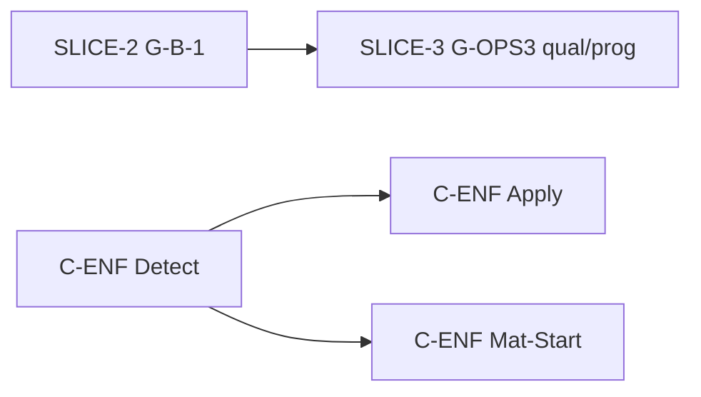

# Programme B — après recette gel A (2026-10-16)

**Contexte** — Gel **A** clôturé. Programme B : slices §11C.4 **un par un** — voir [programme-b-arbitration-2026-10-16.md](./programme-b-arbitration-2026-10-16.md).

**Distinction** — **C-ENF** **Closed** (**G-C-INV** §12 **Done**). **SLICE-2** **Closed** (`c1a12ec4`) avec réserve SPA ; §12 **G-B-1** reste **Deferred**. **SLICE-3** : **Authorized**, code `472546bb`, clôture formelle **en attente**.

---

## État livré (ne pas rouvrir sans anomalie)

| ID | Statut |
|----|--------|
| **G-B-3** / **SLICE-1-G-B-3-ENF** | **Closed** — pool `EntryId` + Applied draw |

---

## Arbitrage 2026-10-16 (non = livré)

| ID | Statut gouvernance | Notes |
|----|-------------------|--------|
| **G-B-1** / **SLICE-2-G-B-1-ENF** | **Closed** (`c1a12ec4`) | B-Q3a domain/app ; réserve SPA · §12 **G-B-1 Deferred** — [fiche](./slice-2-g-b-1-enf.md) |
| **G-OPS3** reliquat qual/prog / **SLICE-3** | **Authorized** — **G-OPS3** §12 **Partial** | Gate qual/prog ; pas Done |
| **C-ENF** (Detect / Apply / Mat-Start) | **Closed** (feat `279b6235`, `85360d3`, `ee0fc2e6` ; gouvernance `7f3acca0`) | **G-C-INV** §12 **Done** — ne pas rouvrir sans anomalie |
| **G-MAT3 / G-MAT4** | **Deferred** | Inchangé |

---

## Ordre recommandé (produit)

| Priorité | Backlog | Slice | Statut |
|----------|---------|-------|--------|
| **P2** | **G-B-1-ENF** | [slice-2](./slice-2-g-b-1-enf.md) | **Closed** (`c1a12ec4`) ; §12 **G-B-1 Deferred** (SPA reserve) |
| **P2b** | **G-OPS3** qual/prog | [slice-3](./slice-3-g-ops3-qual-prog-enf.md) | **Authorized** — code `472546bb` ; G-OPS3 §12 **Partial** |
| **P3a** | **C-ENF-Detect** | [slice-c-enf-detect](./slice-c-enf-detect.md) | **Closed** (`279b6235`) |
| **P3b** | **C-ENF-Apply** | [slice-c-enf-apply](./slice-c-enf-apply.md) | **Closed** (`85360d3`) |
| **P3c** | **C-ENF-Mat + Start** | [slice-c-enf-mat-start](./slice-c-enf-mat-start.md) | **Closed** (`ee0fc2e6`) |

---

## Branche (référence locale)

`feature/new_version` : **C-ENF** clôturé ; **SLICE-2** **Closed** (livraison `c1a12ec4` ; gouvernance `docs(structure-lifecycle): close SLICE-2-G-B-1-ENF with SPA reserve`). **SLICE-3** : **Authorized**, livraison `472546bb`, clôture formelle en attente. Stash WIP optionnel. Publication (push) = décision distincte.

---

## Références

[programme-b-arbitration-2026-10-16.md](./programme-b-arbitration-2026-10-16.md) · [implementation-plan-post-11c.md](./implementation-plan-post-11c.md) · [phase-mutability-matrix.md](./phase-mutability-matrix.md) §11C.4 · §12
