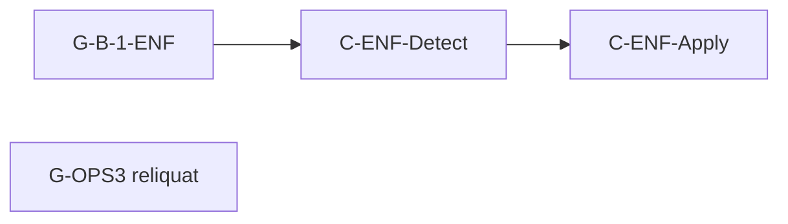

# Programme B — après recette gel A (2026-10-16)

**Contexte** — Gel **A** (capacité D4 / présentation lifecycle) clôturé. **B** = lignes §12 **Deferred** / **Partial** et slices §11C — **pas** d’implémentation sans **slice §11C.4** ou réouverture d’arbitrage explicite.

---

## État livré (ne pas rouvrir sans anomalie)

| ID | Statut |
|----|--------|
| **G-B-3** / **SLICE-1-G-B-3-ENF** | **Closed** — pool `EntryId` + Applied draw |
| **G-OPS3** | **Partial** — affectation pool seulement ; [wave-2-g-b-3-g-ops3-closure.md](./wave-2-g-b-3-g-ops3-closure.md) |
| **G-MAT3 / G-MAT4** | **Deferred** — décision signée « pas de gate » |
| **C-ENF-*** | **Forbidden** hors slice nommé |

---

## Ordre recommandé (produit)

| Priorité | Backlog | Livrable cible | Bloquant |
|----------|---------|----------------|----------|
| **P2** | **G-B-1-ENF** | ≤1 tirage non annulé / phase (B-Q3a) | **Nouveau slice §11C.4** + fiche type [slice-1-g-b-3-enf.md](./slice-1-g-b-3-enf.md) |
| **P3a** | **C-ENF-Detect** | Prédicat obsolete **D** + surfacing | Slice dédié ; Layer 4 addendum |
| **P3b–d** | **C-ENF-Apply / Mat / Deps** | Refus consommation obsolete | Dépend de Detect (ou même slice si DM l’autorise explicitement) |
| **—** | **G-OPS3** (qual/prog, obsolete) | Extension R-Draw1 | Arbitrage D3-2 / piste **C** — distinct de G-B-3 |
| **—** | **G-MAT3/4** | Gates materialize conditionnels | **Réouverture** session arbitrage — pas par défaut |
| **—** | **D1 awards** | Cas limites attribution Prêt | Arbitrage produit |

---

## Prochain slice proposé : **G-B-1-ENF** (à autoriser)

**Problème** — Domaine autorise plusieurs tirages non annulés ; contrat B-Q3a = **≤1** par phase.

**Périmètre slice (ébauche, non autorisé)** — Refus `CreateDraw` (et chemins équivalents) quand un tirage non `Cancelled` existe déjà ; tests référence B-Q3a ; **pas** de bundle avec C-ENF.

**Hors scope** — UI seule ; concurrency globale (sauf limite documentée comme G-B-3).

**Décision requise** — Enregistrer **SLICE-2-G-B-1-ENF** (ou ID DM) dans matrice §11C.4 + Notion avant tout code.

---

## Références

[implementation-plan-post-11c.md](./implementation-plan-post-11c.md) · [phase-mutability-matrix.md](./phase-mutability-matrix.md) §12 · [section-11c-addendum-clarification-arbitration.md](./section-11c-addendum-clarification-arbitration.md).
