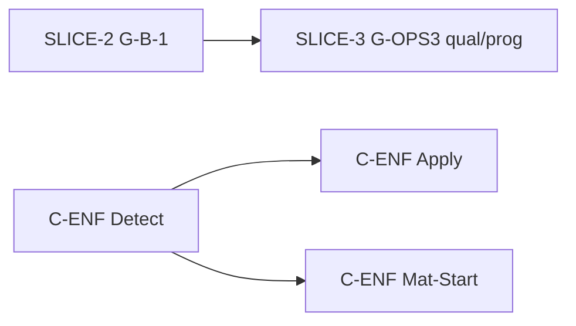

# Programme B — après recette gel A (2026-10-16)

**Contexte** — Gel **A** clôturé. Programme B : slices §11C.4 **un par un** — voir [programme-b-arbitration-2026-10-16.md](./programme-b-arbitration-2026-10-16.md).

**Distinction** — Slices Programme B arbitrées **Closed** (SLICE-1..3 + C-ENF). §12 ouvert : **G-B-1** **Deferred** (réserve SPA), **G-OPS3** **Partial** (reliquat draw-rules / autres commandes), **G-MAT3/4** **Deferred**. **G-C-INV** **Done** — C-ENF sans réouverture sans anomalie.

---

## État livré (ne pas rouvrir sans anomalie)

| ID | Statut |
|----|--------|
| **G-B-3** / **SLICE-1-G-B-3-ENF** | **Closed** — pool `EntryId` + Applied draw |

---

## Arbitrage 2026-10-16 (non = livré)

| ID | Statut gouvernance | Notes |
|----|-------------------|--------|
| **G-B-1** / **SLICE-2-G-B-1-ENF** | **Closed** (`c1a12ec4`) | B-Q3a domain/app ; réserve SPA · §12 **G-B-1 Deferred** — [fiche](./slice-2-g-b-1-enf.md) |
| **G-OPS3** reliquat qual/prog / **SLICE-3** | **Closed** (`472546bb`) | Qual/prog Applied gate ; réserves preuve · §12 **G-OPS3 Partial** — [fiche](./slice-3-g-ops3-qual-prog-enf.md) |
| **C-ENF** (Detect / Apply / Mat-Start) | **Closed** (feat `279b6235`, `85360d3`, `ee0fc2e6` ; gouvernance `7f3acca0`) | **G-C-INV** §12 **Done** — ne pas rouvrir sans anomalie |
| **G-MAT3 / G-MAT4** | **Deferred** | Inchangé |
| **G-OPS3** piste **B1** / **SLICE-G-OPS3-B1-CUP-SLOT-PLACEMENT** | **Closed** (`c9029ba0`) ; réserves R4/T7 · §12 **G-OPS3 Partial** — [fiche](./slice-g-ops3-b1-cup-slot-placement.md) |

---

## Ordre recommandé (produit)

| Priorité | Backlog | Slice | Statut |
|----------|---------|-------|--------|
| **P2** | **G-B-1-ENF** | [slice-2](./slice-2-g-b-1-enf.md) | **Closed** (`c1a12ec4`) ; §12 **G-B-1 Deferred** (SPA reserve) |
| **P2b** | **G-OPS3** qual/prog | [slice-3](./slice-3-g-ops3-qual-prog-enf.md) | **Closed** (`472546bb`) ; §12 **G-OPS3 Partial** (proof reserves) |
| **P3a** | **C-ENF-Detect** | [slice-c-enf-detect](./slice-c-enf-detect.md) | **Closed** (`279b6235`) |
| **P3b** | **C-ENF-Apply** | [slice-c-enf-apply](./slice-c-enf-apply.md) | **Closed** (`85360d3`) |
| **P3c** | **C-ENF-Mat + Start** | [slice-c-enf-mat-start](./slice-c-enf-mat-start.md) | **Closed** (`ee0fc2e6`) |

---

## Branche (référence locale)

`feature/new_version` : slices arbitrées **Closed** (feat + docs gouvernance). **SLICE-2** : livraison `c1a12ec4` ; gouvernance `docs(structure-lifecycle): close SLICE-2-G-B-1-ENF with SPA reserve`. **SLICE-3** : livraison `472546bb` ; gouvernance `docs(structure-lifecycle): close SLICE-3-G-OPS3-QUAL-PROG-ENF with G-OPS3 partial reserve`. **SLICE-G-OPS3-B1** : livraison `c9029ba0` ; gouvernance `docs(structure-lifecycle): close SLICE-G-OPS3-B1-CUP-SLOT-PLACEMENT with G-OPS3 partial reserve`. Stash WIP optionnel. Publication (push) = décision distincte.

### B-Q1b `ReplaceStageDrawRules` en Ready — preuve (sans slice §11C.4)

| Couche | Statut | Preuve |
|--------|--------|--------|
| Application / domaine | Refus **Ready** (`EnsureStructureMutable` → `Stage.StructureLocked`) | `ReplaceStageDrawRulesTests.Replace_rejected_when_stage_is_Ready` |
| Host HTTP | **409** + wire `Stage.StructureLocked` sur `PUT /draw-rules` après **Prepare** | `ReplaceStageDrawRulesEndpointTests.Put_draw_rules_when_ready_returns_409_StructureLockedAsync` |
| SPA / hub | Pas d’action `ReplaceDrawRules` en Ready (Δ-03) | `StructureViewAssemblerDrawRulesTests` |

**Pas** de nouveau garde-fou métier — fermeture d’un **écart de preuve** seulement. **G-OPS3** §12 reste **Partial** ; reliquat invalidation (draw-rules sémantique / autres commandes) = **arbitrage distinct** (piste B), pas couvert par B-Q1b.

---

## Références

[programme-b-arbitration-2026-10-16.md](./programme-b-arbitration-2026-10-16.md) · [implementation-plan-post-11c.md](./implementation-plan-post-11c.md) · [phase-mutability-matrix.md](./phase-mutability-matrix.md) §11C.4 · §12
